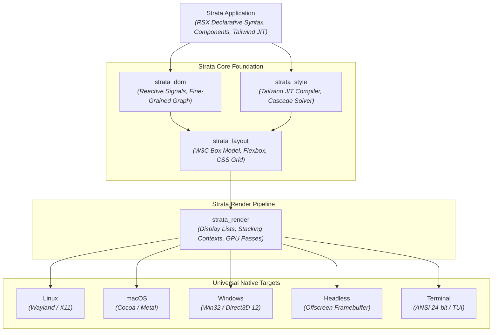

# Strata UI

**Pure-Rust Universal Presentation Engine, Zero-Chromium Native Runtime, and Component Systems.**

Strata is an open-source systems software organization engineering high-performance presentation engines, declarative user interface frameworks, and deterministic web runtimes entirely in safe Rust.

---

### Architectural Foundations

Unlike legacy cross-platform frameworks (Electron, CEF, Tauri, or React Native), Strata never embeds Chromium, WebViews, or heavyweight JavaScript engines. Instead, Strata implements a complete W3C-compliant layout pipeline, cascading style engine, reactive signal runtime, and GPU compositor directly in safe Rust.

---

### Ecosystem Portfolio

| Repository | Scope | Description |
| :--- | :--- | :--- |
| [**`strata`**](https://github.com/strataui/strata) | **Core Engine** | Pure-Rust universal presentation engine, W3C layout engine, fine-grained reactive signals, Tailwind JIT, display list GPU compositor, and accessible UI primitives. |
| [**`mica`**](https://github.com/strataui/mica) | **ECMAScript Runtime** | Lightweight, zero-dependency ECMAScript interpreter, recursive-descent AST parser, and W3C DOM simulation engine in pure safe Rust. |
| [**`onyx`**](https://github.com/strataui/onyx) | **Native Web Browser** | High-performance, sovereign zero-Chromium web browser built natively on Strata and Mica. Sub-50ms cold startup and minimal RAM footprint. |
| [**`earth`**](https://github.com/strataui/earth) | **3D Geospatial Engine** | High-precision f64 WGS84 geodesy, quadtree tile LOD streaming, camera horizon clipping, and digital twin engine. |
| [**`cli`**](https://github.com/strataui/cli) | **Developer Toolchain** | Universal CLI (`cargo strata`), scaffolding generators, state-preserving native hot-reloading orchestrator, and multi-target native packager. |
| [**`vscode`**](https://github.com/strataui/vscode) | **Editor Integration** | Language Server Protocol (LSP 3.17) server, tree-sitter grammars, inline Tailwind color previews, and diagnostics for VS Code and Cursor. |
| [**`docs`**](https://github.com/strataui/docs) | **Documentation & Sandbox** | Comprehensive architectural guides, API specifications, mdBook interactive documentation, and live WebAssembly component gallery. |

---

### Core Tenets

1. **Zero Chromium**: No embedded WebViews, no Blink, no CEF, and no V8. The entire presentation and layout pipeline runs as native machine code.
2. **Deterministic Memory**: Zero garbage collection pauses in the rendering loop. Display lists and layout trees are allocated into reusable memory arenas.
3. **Universal Target Matrix**: Identical declarative RSX components compile natively to Wayland/X11, macOS AppKit, Windows Win32, Android NativeActivity, iOS UIKit, WebAssembly, and interactive ANSI/TUI terminal surfaces.
4. **Sub-Millisecond Invalidation**: Reactive signals invalidate only affected subtrees and style masks, eliminating full-tree virtual DOM reconciliation overhead.

---

### Standards & Licensing

- **Specification Compliance**: W3C CSS Box Model, CSS Flexible Box Layout Module Level 1, CSS Grid Layout Module Level 2, WCAG 2.1 AAA Accessibility.
- **Licensing**: All foundational repositories in the Strata ecosystem are distributed under the MIT License.
